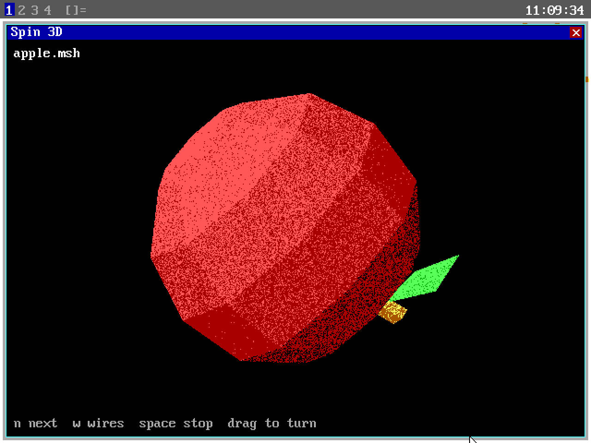
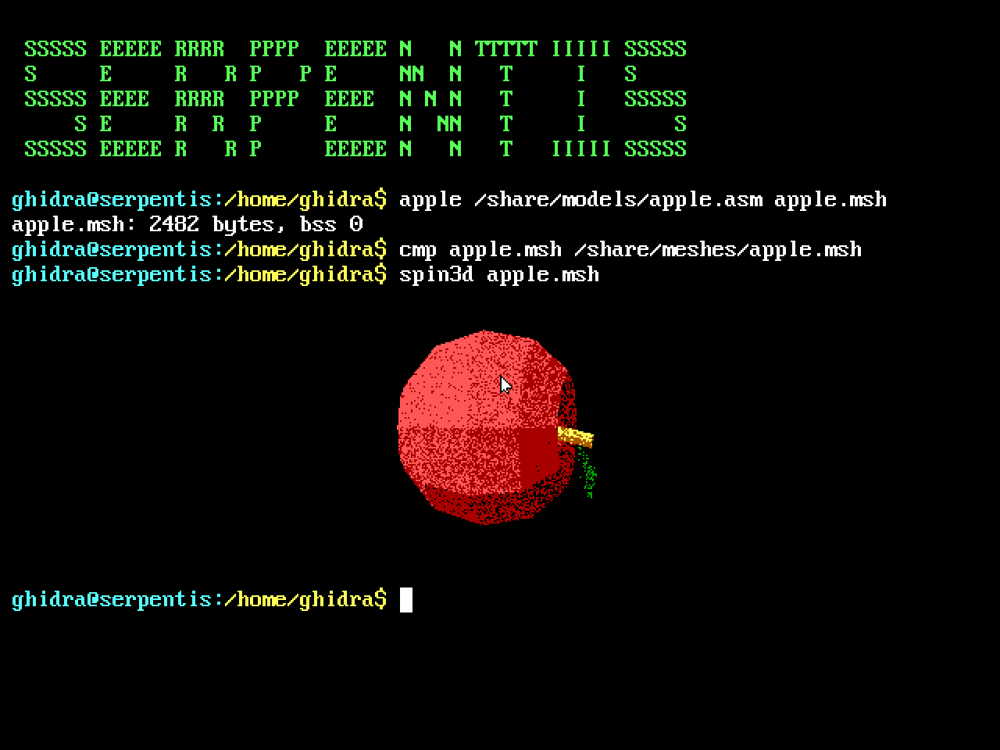
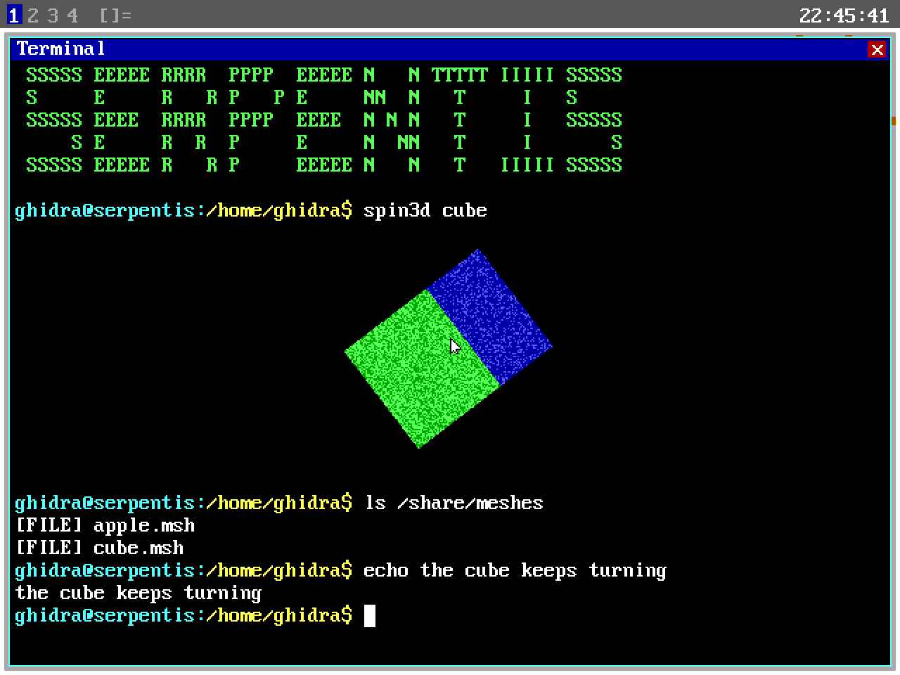

# gfx3d

gfx3d is the 3d library of serpentis-os (github.com/ghidra-devos/serpentis-os), split out so it can be read on its own. It is one fasm include, gfx3d.inc (about 2800 lines), plus gfx3d_bss.inc for its variables. It draws meshes and 3d primitives into any 8 bit surface you give it, with a z buffer and no perspective: x and y go straight to the screen and z only sorts.

## what works

- matrix stack of 8, 4x4 floats, multiply on the right (gl order) or on the left
- meshes with back face culling, z buffer, near plane clipping, one light
- shading with the 16 ega colors: a lit face is a per pixel mix of its color and color xor 8, a dark one a mix with black
- points, lines, arrows, filled polygons, circles, ellipses, arcs, beziers, b-splines, text at a 3d point, flood fill, mirror plane
- g3_unproject (screen point to 3d) and g3_pick (vertex under the mouse)
- scalar sse only, so apple (the assembler inside serpentis-os) can build it
- every call keeps rbx rbp r12-r15 and trashes the rest, xmm too. The comment at the top of gfx3d.inc lists every call and its registers

## mesh format

A byte 24, vertex and triangle counts as i32, i32 x y z per vertex, i32 color and three vertex numbers per triangle, a zero byte at the end. Color bit 0x1000 is half range, 0x2000 two sided. models/model.inc has the macros (vertex, triangle, quad, lathe, ring) the models are written with.

    apple /share/models/apple.asm apple.msh

apple.asm has 62 vertices and 108 triangles, cube.asm 8 corners and 12 triangles.

## usage

    mov rdi, [pixels]           ; 8 bit surface
    mov esi, [stride]
    mov edx, [width]
    mov ecx, [height]
    mov r8, [zbuffer]           ; width * height dwords
    call g3_begin
    mov edi, PALETTE_FIXED      ; black
    call g3_clear

    movss xmm0, [angle]
    call g3_rotate_y
    lea rdi, [mesh]
    call g3_fit                 ; last before drawing
    lea rdi, [mesh]
    xor esi, esi
    call g3_draw_mesh

example/spin3d.asm is a full program: alone it opens a window and turns the meshes, with a name it hands the mesh to the serpentis terminal.

## build

The library calls nothing from the os, but the example and the text drawing need the serpentis runtime (draw.inc, program.inc, gui and screen includes). Drop it in a serpentis-os tree and build there:

- gfx3d.inc and gfx3d_bss.inc in apps/runtime
- example/spin3d.asm as apps/spin3d/spin3d.asm
- models/ at the top of the tree
- then build.sh or build.bat

## known issues

- the flood fill drops seeds when its stack is full, a huge ragged area can come out with holes
- no perspective
